    

<h1 align="center">Hi, I'm Mostafa Ahmed Boraie</h1>

  <b>Junior Network Engineer</b> — Cisco Networking, Routing &amp; Switching, Troubleshooting

    

  

## About Me

- 🌐 Network Engineer focused on Cisco routing & switching and network troubleshooting
- 💼 2+ years of hands-on experience in network labs and technical support at **SCAL Academy** — Cisco routers, switches, IP phones and PoE
- 🎓 Bachelor of Commerce, Cairo University (graduated 2026)
- 🔐 Currently learning **CCNP Security**
- 💬 Ask me about **VLANs, STP, EtherChannel, OSPF, NAT, DHCP, ACLs and Subnetting**
- 🎯 Open to **Junior Network Engineer** opportunities
- 📫 Reach me at **Mostafaaboraie@gmail.com**
- 📍 6th of October City, Egypt

## Core Networking Skills

  
  
  
  
  
  
  
  
  
  

## Tools I Use

  
  
  
  
  
  

## Training & Course Completions

  
  

  
  
  

*Cisco Networking Academy course completions at SCAL Academy — course completions, not vendor certifications.*

  

## Featured Project

### [Multi-Branch Network Design — Cisco Packet Tracer](https://github.com/MostafaAhmed-IT/packet-tracer-multi-branch-network)

A complete two-branch company network designed and configured in Cisco Packet Tracer:

- Two branch sites, each with 4 switches and around 16 end devices
- Per-department VLANs: IT, Office, HR and Management
- Spanning Tree with planned root placement, sticky-MAC Port Security
- Per-VLAN DHCP, NAT (PAT) and inter-department ACLs

## GitHub Stats

  
  

## Connect With Me

  
  

  

